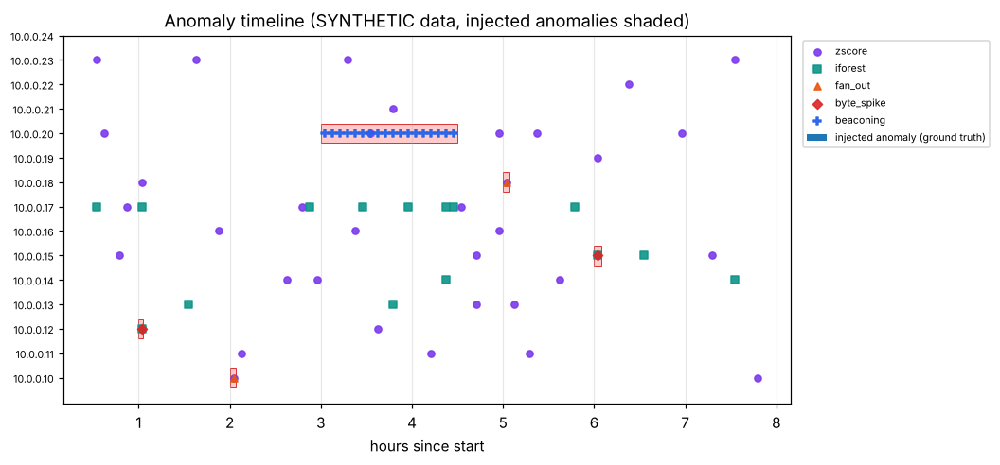
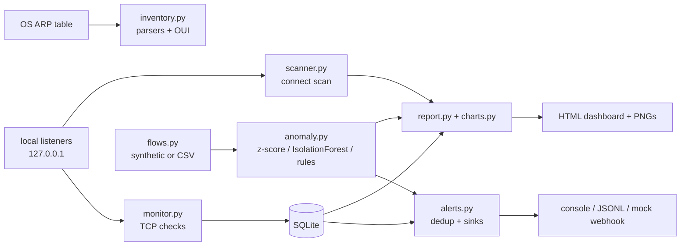
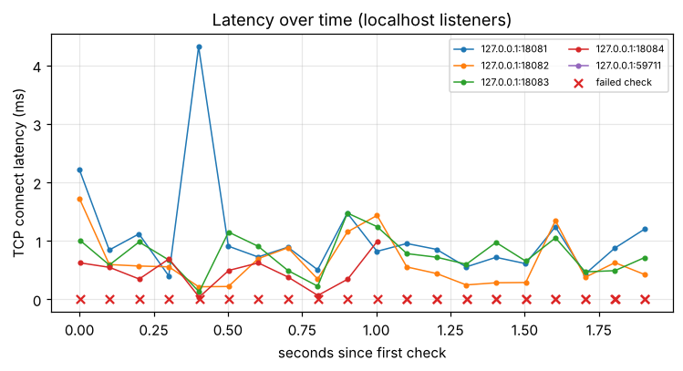
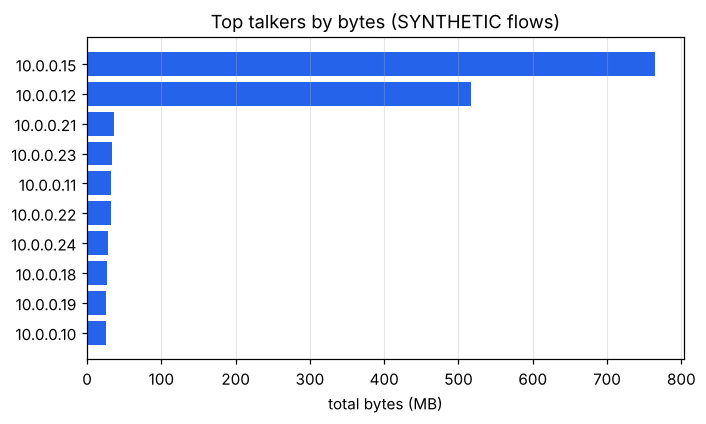

# Network Monitoring System

A small, defensive network monitoring toolkit in Python: TCP availability/latency monitoring, a rate-limited connect port scanner, a device inventory built from the OS neighbour (ARP) table, anomaly detection on **synthetic** NetFlow-like records, an alert engine, and a self-contained HTML dashboard.

> **Safety notice:** use this tool only on networks and devices you **own or are explicitly authorised to test**. Unauthorised scanning may be illegal. Scan and monitor targets must be given explicitly as `localhost`, an IPv4 literal or a small CIDR (max 256 addresses); no DNS lookups are made. Public (non-loopback, non-RFC1918) addresses are **refused** unless you pass `--i-own-this`.

**ملخص بالعربية:** مشروع دفاعي لمراقبة الشبكات بلغة بايثون: مراقبة التوفر وزمن الاستجابة عبر اتصالات TCP، وماسح منافذ محدود المعدّل، وجرد للأجهزة من جدول ARP الخاص بالنظام، وكشف الشذوذ على بيانات تدفق **اصطناعية** (غير حقيقية) مع أنظمة تنبيه ولوحة HTML مستقلة. يُستخدم فقط على الشبكات والأجهزة التي تملكها أو لديك إذن صريح باختبارها. لا يدعم تحليل ملفات pcap.



## Features

- **Monitor:** TCP connect checks run concurrently (`concurrent.futures`, workers capped at 64), latency sampling, mean/p95/max, jitter (mean absolute difference between consecutive successful latencies) and failure rate; results stored in SQLite.
- **Port scanner:** TCP connect scan with a common-ports preset (25 ports) or custom ranges (max 4,096 ports), bounded workers (max 64), a connections-per-second rate limit (default 200) and **passive banner grab that is off by default** (`--banner`).
- **Device inventory:** pure parser functions for `ip neigh`, `arp -a` (Linux/macOS and Windows layouts) and `/proc/net/arp`, unit-tested on sample text. Vendor lookup uses a **small bundled JSON of 17 well-known prefixes only** (VMware, VirtualBox, QEMU, Hyper-V, Raspberry Pi, a few large vendors), not the IEEE registry, so most real devices show as `unknown`.
- **Flow analyzer:** reads NetFlow-like CSV (`ts,src,dst,dst_port,proto,bytes,packets`) or a bundled **synthetic** generator with labelled injected anomalies. Per-host, per-5-minute-bin features (bytes, packets, unique destination ports, unique destination hosts); detectors: rolling z-score, scikit-learn IsolationForest, and three rules (fan-out / port-scan-like, beaconing via inter-arrival regularity, large byte spike).
- **Alert engine:** severities (info/warning/critical), minimum-severity filter, dedup with cooldown (repeats inside the cooldown are suppressed unless severity escalates), sinks: console, JSONL file, and a mock webhook that builds the payload in memory and sends nothing.
- **Dashboard:** one self-contained HTML file with inline base64 PNGs (latency over time, top talkers, anomaly timeline) and an open-ports table. No scripts, no external requests.
- argparse CLI with subcommands, logging, 33 pytest tests.

**Out of scope:** pcap/packet capture parsing. The flow analyzer works on flow records only.

## Architecture



## Quickstart

```bash
python -m pip install -r requirements.txt   # numpy, pandas, scikit-learn, matplotlib, pytest
python scripts/demo.py                      # listeners -> monitor + scan -> synthetic flows -> docs/
python -m pytest -q
```

Open `docs/sample_dashboard.html` in a browser (generated by the demo and committed as a sample).

## CLI usage

```bash
python -m netmon monitor 127.0.0.1:8080 127.0.0.1:5432 --count 20 --interval 1 --db output/m.db
python -m netmon scan localhost --ports common            # or --ports 22,80,8000-8100
python -m netmon scan 192.168.1.0/28 --rate 100           # only RFC1918 / loopback unless --i-own-this
python -m netmon inventory                                # live neighbour table
python -m netmon inventory --file saved_arp.txt           # parse saved ip neigh / arp -a / /proc/net/arp text
python -m netmon flows generate --out output/flows.csv --labels output/labels.json
python -m netmon flows analyze --csv output/flows.csv --labels output/labels.json
python -m netmon dashboard --db output/m.db --out dashboard.html
```

Refusing a public target (real output):

```text
$ python -m netmon scan 8.8.8.8
error: 8.8.8.8: public/non-RFC1918 addresses are refused. Pass --i-own-this only if you own or are authorised to test it.
```

## Demo output

Real output of `python scripts/demo.py`. The demo opens four listeners on 127.0.0.1 (ports 18081-18084), stops one of them after round 10, and also monitors one closed port. Latencies are localhost TCP connect times and vary from run to run; the flow section is deterministic (seed 7).

```text
== Monitor: 5 local targets, 20 rounds (one listener stops after round 10, one port is closed)
target                   n  fail%  mean ms   p95 ms  jitter ms
127.0.0.1:18081         20      0    0.822    1.472      0.490
127.0.0.1:18082         20      0    0.818    1.507      0.589
127.0.0.1:18083         20      0    0.794    1.602      0.488
127.0.0.1:18084         20     45    0.663    2.314      0.549
127.0.0.1:39229         20    100        -        -          -

== Alerts from monitor stats
[WARNING ] high_failure_rate 127.0.0.1:18084: 9/20 checks failed (45%)
[CRITICAL] target_down 127.0.0.1:39229: all 20 checks failed

== Port scan of 127.0.0.1 (common preset + 18000-18100)
scanned 126 ports in 0.25s, open: [18081, 18082, 18083]

== Flow analysis on SYNTHETIC flows with injected anomalies (seed 7)
29,292 flows, 1,440 host-bins, 73 detections, 5 injected anomalies
method              TP   FP   FN   prec  recall    F1  events
zscore               5   31   19   0.14    0.21  0.17  5/5
iforest              2   13   22   0.13    0.08  0.10  2/5
fan_out              2    0   22   1.00    0.08  0.15  2/5
byte_spike           2    0   22   1.00    0.08  0.15  2/5
beaconing           18    0    6   1.00    0.75  0.86  1/5
rules (combined)    22    0    2   1.00    0.92  0.96  5/5
all (combined)      22   44    2   0.33    0.92  0.49  5/5
```

(The demo then prints the flow alerts: 10 emitted, 12 suppressed by the 15-minute cooldown.)

### How to read the detection table

- Data: 15 synthetic hosts, 8 hours, 29,292 flow records, with 5 injected anomalies (a 150-port scan, a 40-host sweep, 90 minutes of 60-second beaconing, two byte spikes). The ground truth covers 24 (host, 5-minute bin) cells out of 1,440.
- Precision/recall are computed per (host, bin) cell. "events" is how many of the 5 injected anomalies each method hit in at least one cell.
- The **rule detectors reach precision 1.00 / recall 0.92 only because the thresholds were chosen with these injected patterns in mind** and the background traffic is simple (Poisson arrivals, no legitimately periodic traffic such as NTP or polling). A real network would produce false positives from periodic services.
- The statistical detectors are weaker here: the rolling z-score finds all 5 events but with precision 0.14 (31 false positives), and IsolationForest (contamination fixed at 0.01) has precision 0.13 and recall 0.08. Combining everything raises recall but drops precision to 0.33.
- This is one seed on one synthetic generator. It shows the evaluation code works; it is not a benchmark and says nothing about real traffic.

| Latency over time | Top talkers (synthetic) |
|---|---|
|  |  |

## Project structure

```text
netmon/        safety, monitor, scanner, inventory (+ data/oui.json), flows, anomaly, alerts, charts, report, cli
scripts/       demo.py
tests/         33 pytest tests
docs/          generated PNG charts and sample_dashboard.html
```

## Testing

```bash
python -m pytest -q      # 33 passed
```

Tests open real sockets on 127.0.0.1 for the monitor and scanner (open vs closed ports, passive banner on/off, rate limiter spacing), check target-safety refusals, parse sample `ip neigh` / `arp -a` / `/proc/net/arp` text, verify jitter and failure-rate arithmetic on known values, test the beaconing/fan-out/byte-spike rules on constructed data, check precision/recall on hand-built labels, alert cooldown/escalation/sinks, CSV ingest and the dashboard HTML.

## Limitations

- **All flow data is synthetic** (documentation-range addresses). Detection metrics describe the generator, not real networks; rule thresholds were tuned against it.
- No pcap or live packet capture; flows come from CSV or the generator only.
- The scanner is a plain TCP connect scan: no UDP, no SYN scan, no service fingerprinting. The optional banner grab only reads what a service volunteers.
- Monitoring is TCP connect only (no ICMP, HTTP or DNS checks). Latency on localhost is not representative of a real network.
- OUI lookup covers 17 prefixes; locally administered MACs are flagged as such. IPv6 neighbours are parsed from `ip neigh` but IPv6 scan targets are not supported.
- Rolling z-score baselines include earlier anomalous bins, and IsolationForest is fitted on the same data it scores.
- The mock webhook does not send anything. Not tested on Windows or macOS beyond sample parser text.
- Not hardened or audited; it is a portfolio project, not a replacement for established monitoring tools.

## Roadmap

- Real webhook sink restricted to configured URLs, with retries.
- ICMP/HTTP/DNS checks; scheduled monitoring with a persistent service mode.
- Evaluate on a public flow dataset (e.g. CIC-style CSVs) and benchmark against held-out labels.
- Larger OUI data file loaded from the IEEE registry offline.

## Built with AI assistance

This project was built with the help of an AI assistant (Claude). The code, tests and README were drafted with AI help; the numbers above are pasted from real runs of the code in this repository. Review it before relying on it.

## License

MIT, see [LICENSE](LICENSE).
